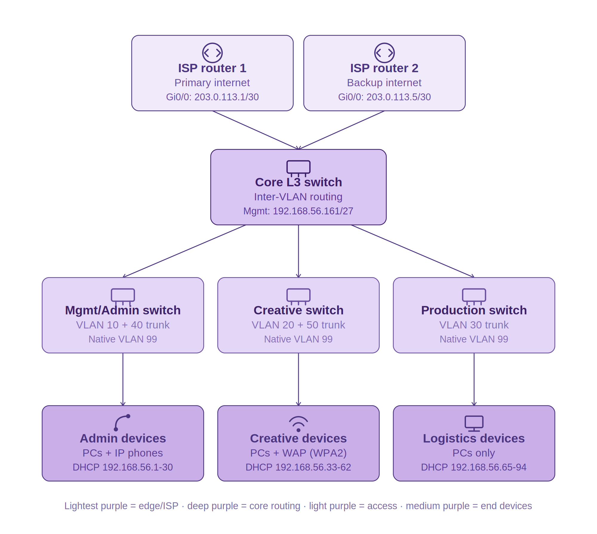
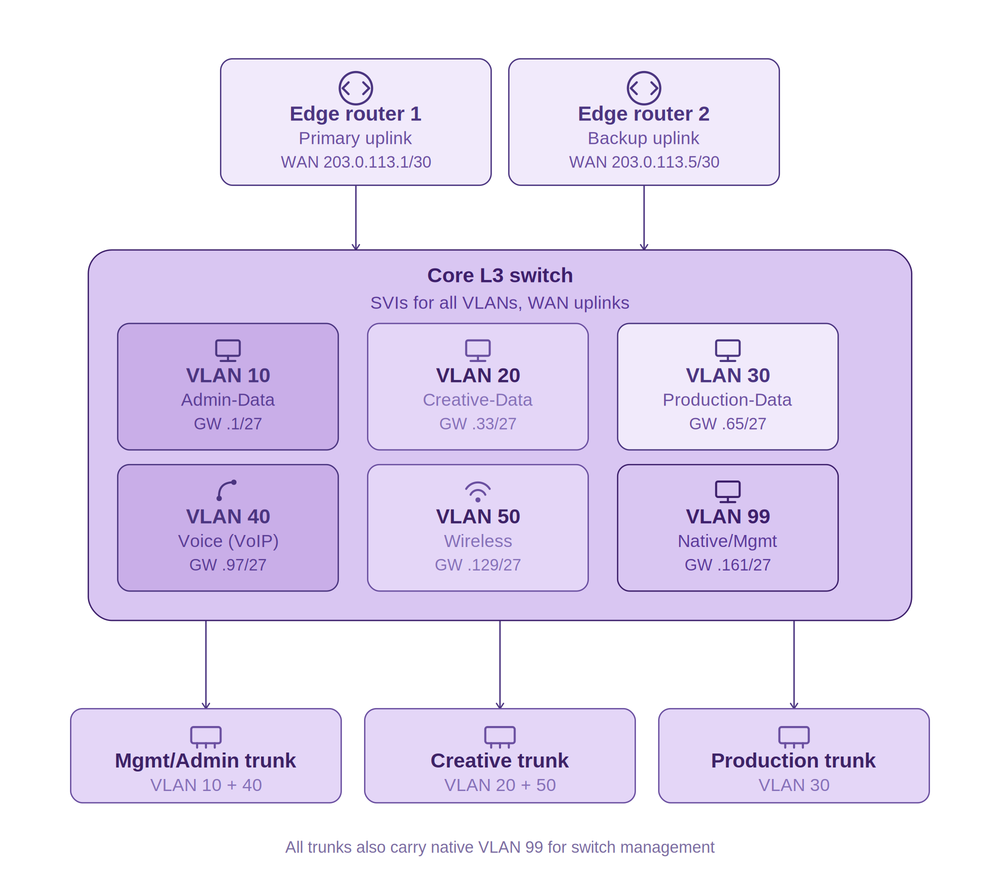

# CMPG325 Individual Network Project Portfolio

**Student:** Shivuri, Nyeleti
**Student number:** 42718910
**Project ID:** CMPG325-2026-133
**Client ID:** CLI-133
**Assigned organisation:** Khumo Advertising Billboards (Vryburg)
**Industry:** Media

---

## Project Overview

This repository is the portfolio of evidence for my CMPG325 individual network project. The brief assigns Khumo Advertising Billboards (Vryburg) as the client, with a fixed addressing block, a mandatory design constraint separating VoIP and data traffic, an assigned wireless security challenge (WPA2-PSK hardening), and a resilience change request requiring a second internet connection.

Where the brief did not specify organisational detail, I made and documented reasonable network engineering assumptions, consistent with my lecturer's guidance for this project.

---

## Repository Structure

| Folder | Contents |
|---|---|
| `01-client-requirements/` | Client requirements and documented engineering assumptions |
| `02-topology/` | Physical and logical topology diagrams, including editable draw.io source files |
| `03-ip-addressing/` | VLAN table, IP addressing plan, WAN links, and trunk configuration |
| `04-packet-tracer/` | Packet Tracer project file (`Khumo_Network.pkt`) |
| `05-configuration/` | Full running configuration export for every device, plus the wireless access point's security configuration |
| `06-testing/` | Testing evidence screenshots and summary covering all connectivity and security tests |
| `07-troubleshooting/` | Detailed troubleshooting log documenting issues encountered and resolved |
| `08-reflection/` | Final project reflection |
| `09-report/` | Full technical report in Markdown, with embedded figures |

---

## Project Status

### Milestone 1 — Client Design Review: Complete

Client requirements, documented assumptions, physical topology, logical topology, VLAN design, IP addressing plan, and the initial GitHub repository were all submitted.

### Milestone 2 — Client Implementation Review: Complete

The following has been built, configured, and verified:

- All devices placed, labelled, and cabled according to the physical topology
- Core Layer 3 switch configured with VLANs, switch virtual interfaces, trunking, and DHCP pools
- All three access switches configured with correct trunk and access ports
- Edge routers configured with WAN uplinks to both internet service providers
- Dual ISP resilience tested in both directions, with live traffic confirmed during failover and after the primary link was restored
- Inter-VLAN routing verified with live pings between all three departments
- All PCs and IP phones confirmed on DHCP with correct department-based addressing
- Voice VLAN separation confirmed at the port level and in the DHCP binding table
- WPA2-PSK with AES encryption configured on the Creative wireless access point, with both a successful connection and a rejected incorrect password tested
- Full running configuration exported for all six network devices
- Administrative passwords and login banners applied across all devices

### Milestone 3 — Final Evaluation: Complete

- Technical report finalised and submitted as `09-report/Technical_Report.md`
- All testing evidence consolidated into `06-testing/` with a summary file
- Troubleshooting log finalised in `07-troubleshooting/`
- Final Packet Tracer file verified after a fresh close and reopen
- Video demonstration recorded and linked below

**Not yet attempted:** the WPA2-Enterprise optional extension mentioned in the brief. This is documented as a future recommendation in the technical report.

---

## Design Summary

### Topology

The network follows a three-tier hierarchical design: an edge layer with two independent ISP connections, a core Layer 3 switch handling all inter-VLAN routing, and an access layer of three switches serving each department separately. This structure satisfies the dual ISP resilience requirement and keeps departmental traffic cleanly separated down to the access layer.

*Figure 1: Physical topology*

*Figure 2: Logical topology*

The editable draw.io source files for both diagrams are in `02-topology/`.

### VLAN Design

| VLAN ID | Name | Department |
|---|---|---|
| 10 | Admin-Data | Management and Admin |
| 20 | Creative-Data | Creative and Design |
| 30 | Production-Data | Production and Logistics |
| 40 | Voice (VoIP) | Management and Admin |
| 50 | Wireless | Creative and Design, and meeting rooms |
| 99 | Native/Mgmt | Network infrastructure |

The full justification for this VLAN design is in `03-ip-addressing/ip-addressing-plan.md`.

### IP Addressing

The assigned block, `192.168.56.0/24`, is subnetted into `/27` blocks across six VLANs. The full addressing table with gateways and usable ranges is in `03-ip-addressing/ip-addressing-plan.md`.

### Client Requirements and Assumptions

The full requirements list and the engineering assumptions made where the brief left detail unspecified — covering departments, user counts, wireless and VoIP placement, and the redundancy design — are documented in `01-client-requirements/client-requirements.md`.

---

## How to Open the Project

1. Install Cisco Packet Tracer 8.x.
2. Open `04-packet-tracer/Khumo_Network.pkt`.
3. Wait 60 seconds for spanning-tree convergence and DHCP leases.
4. All PCs will receive addresses automatically.
5. Follow `06-testing/testing-summary.md` to reproduce the test results.

---

## Video Demonstration
https://efundi.nwu.ac.za/access/content/group-user/1b4c43e2-0741-423b-a0bf-eeb2446e3735/42718910/KHUMO_PRESENTATION_N_SHIVURI.mp4 

---

## Technical Report

The full report is at [`09-report/Technical_Report.md`](09-report/Technical_Report.md). It covers design rationale, configuration summary, test results, troubleshooting, limitations, and future work.

---

## Academic Integrity

This project is my own individual work, developed according to the CMPG325-2026-133 project brief. Any AI assistance used in preparing documentation or diagrams complied with the applicable NWU AI Policy. I remain responsible for the correctness, understanding, and academic integrity of everything submitted.
